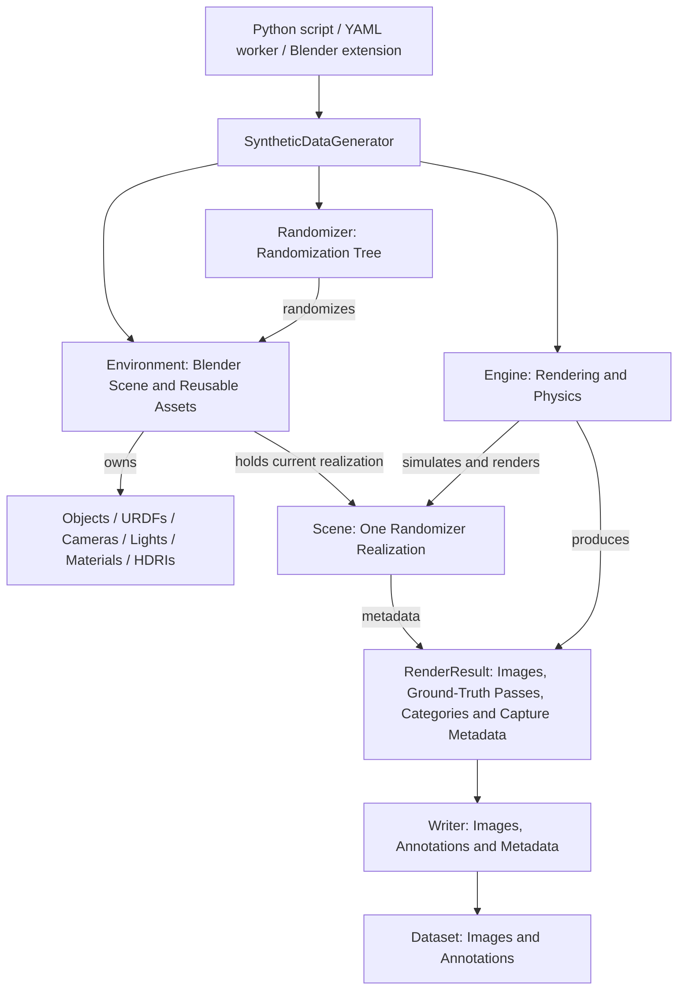

# Architecture

`telekinesis-illusion` turns an environment and randomization rules into
rendered datasets. `Environment` represents the active Blender scene and owns
the reusable generation assets. A **scene** is one particular realization of
that environment under the randomizer tree's rules. The generator coordinates
these realizations, the engine simulates and captures them, and the writer
converts the captured results into dataset files.

An environment persists across samples; each sample realizes a scene with its
selected instances, poses, materials, lighting, background, and camera views.
One scene can produce multiple images. The current realization lives in the
environment's mutable Blender state; there is no separate `Scene` object or
retained snapshot. Blender's own `bpy.types.Scene`, accessed through
`bpy.context.scene`, is the underlying container reused across realizations.

For a first dataset run, see [TUTORIAL.md](TUTORIAL.md). Environment setup,
validation commands, and troubleshooting are in [DEVELOPMENT.md](DEVELOPMENT.md).

## Data flow

The arrows describe responsibilities and data flow. The generator calls the
writer after each capture. The scene's metadata reaches `RenderResult` through
the engine, which captures category and camera information alongside the
rendered passes. The writer consumes that result without querying the live scene.

The diagram includes the system's entrypoints and asset families. This branch
provides Python examples and YAML workers, with `BlenderEngine` as the engine
implementation and `CocoWriter` as the concrete writer. Model loading currently
uses single-mesh `ModelAsset` definitions; a URDF loader and a Blender extension
entrypoint are not included in this source tree.

## Component responsibilities

| Component | Responsibility |
| --- | --- |
| [SyntheticDataGenerator](src/telekinesis/illusion/core/synthetic_data_generator.py) | Coordinates preparation, sampling, simulation, rendering, writing, and cleanup. Enforces the requested image or sample count. |
| [Environment](src/telekinesis/illusion/core/environment.py) | Represents the active Blender scene, owns reusable assets and instance pools, and holds the current realization. |
| Scene (realization) | The selected instances and sampled properties for one generation sample, including its camera views. |
| [Randomizer](src/telekinesis/illusion/randomizer/randomizer.py) | Plans instance capacity and executes the rules that realize or update a scene in the environment. |
| [BlenderEngine](src/telekinesis/illusion/core/engine.py) | Configures rendering and physics, simulates the scene, and produces captured batches. Uses `RenderConfig` and `PhysicsConfig`. |
| [RenderResult](src/telekinesis/illusion/types/render_result.py) | Carries rendered pass data, category mappings, and capture metadata independently of the scene's lifetime. |
| [Writer / CocoWriter](src/telekinesis/illusion/writer/writer.py) | Declares required segmentation attributes and writes a captured batch, returning the number of images written. |

Workers assemble these components from configuration and manage runs or shards.
Dataset merging, train/validation/test splitting, and format conversion happen
after generation. The dataset node represents files on disk.

## Generation lifecycle

`SyntheticDataGenerator.generate()` owns the following sequence:

1. **Prepare.** Ask the randomizer for finite instance capacities, prepare the
   environment's pools, prepare randomizer resources, and configure the engine
   using the writer's segmentation requirements.
2. **Begin a sample.** Deactivate the previously active pooled objects. This
   resets activity; it does not restore every pose or material to a default.
3. **Randomize.** Execute the enabled nodes to select instances and change
   poses, materials, backgrounds, lights, and camera views for this scene.
4. **Simulate when enabled.** Run physics, then resample enabled light-pose nodes
   against the resulting geometry.
5. **Capture and write.** Render the camera views into a `RenderResult`, pass it
   to the writer, and verify that the writer reports the captured image count.
   Repeat from the start of the next sample until the requested count is met.
6. **Clean up.** Release engine and environment resources in `finally`, unless
   the caller retains the prepared environment between generation calls.

`num_images` requests an exact number of camera views. The engine limits the
last batch to the remaining views. `num_samples` instead requests randomized
scenes and captures all configured views for each one. These arguments are
mutually exclusive, and `generate()` returns the number of images written.

Explicit `generator.prepare()` supports setting fixed transforms before the
first sample. Repeated preparation reuses existing pools while checking that
they can satisfy the requested capacity. A caller using
`clean_up_environment=False` owns the final `generator.clean_up()` call, including
when a later operation fails.

## Environment assets and scene realizations

### Registration and instance pools

A [ModelAsset](src/telekinesis/illusion/types/model_asset.py) describes a model;
constructing it does not import geometry. `Environment.add()` validates its path,
scale, name, and annotation category, then returns a normalized copy without
changing the input specification. The environment exposes registered definitions
through a read-only mapping. It also accepts constructed `Light` objects,
registered separately from model definitions and mesh instances.

Preparation imports each requested model once and creates linked duplicates
up to the capacity declared by the randomizer. Linked instances share mesh
data; object-level material slots allow different material assignments.
The flat object dictionary and per-model groups reference the same wrappers.
Instance counts belong to randomization nodes, independently of model metadata.

Model registration closes after preparation. Counts can change within the
prepared capacity, but adding models or increasing capacity requires a new
environment. No model imports or implicit pool growth occur in the sample loop.

### Activity and Blender state

Blender is the source of truth for transforms, geometry, and shader state;
Illusion accesses them through its wrappers. `Environment.activate()` and
`deactivate()` coordinate visibility, rigid-body participation, and the active
object index. Calling a low-level hide operation alone does not perform that
whole transition.

The environment creates its camera, background, and material manager during
construction. Lights must be constructed after the environment. Its asset
directory supplies background and material catalogs. Workers resolve model
paths against their configured asset directory; direct `ModelAsset` paths are
relative to the working directory unless absolute.

There is one active Blender scene per process. Constructing another `Environment`
resets the shared Blender state. A cleaned environment cannot be prepared again,
and wrappers belonging to it must not be reused. Generating the next scene
reuses the active environment rather than constructing another Blender scene.

## Randomization tree

The randomization tree is represented by a directed acyclic graph (DAG).
`add_randomizer()` appends a node to a chain; `add_node()` and `add_edge()` allow
explicit dependencies and shared nodes. Execution uses a stable topological
order, with insertion order resolving ties. Cycles are rejected.

[RandomizerNode](src/telekinesis/illusion/randomizer/randomizer_node.py)
provides three lifecycle hooks: `required_instances()` declares capacity,
`prepare()` loads resources before sampling, and `randomize()` changes the
scene. Composition nodes reserve instances; pose and appearance modifiers do
not reserve additional capacity. Enabled nodes contribute once to the capacity
calculation, and multiple nodes requesting the same model reserve additive
capacity and select distinct available instances.

Nodes cover instance counts, object poses, materials, HDRI backgrounds, light
properties, light poses, and camera poses. Optional stage filtering supports
partial scene updates; enabled nodes assigned to the default stage are never
filtered out. Normal generation executes all enabled nodes.

Randomizer methods and nodes accept the shared `environment` argument. Camera
and light pose nodes invoke their samplers as
`sampler(environment=environment, **kwargs)`; custom samplers must accept that
keyword. `BinPickingWorker.get_environment()` exposes the worker's environment.

Camera pose randomization stores views at Blender frame indices and overwrites
those indices on subsequent samples. It reuses the camera animation rather than
clearing it. Keep the configured view count fixed within a prepared environment:
reducing it leaves earlier frames and animation keys in place.

## Rendering and dataset output

### Engine and capture

`BlenderEngine` uses the local Blender rendering and physics helpers. Rendering
configuration selects the device, sample count, and optional depth and normal
passes. The normal segmentation path uses Blender's object-index pass to
produce instance maps and associated attributes.

Physics is optional. When a catch plane is configured, the engine reuses an
invisible plane below the active container and can deactivate escaped objects.
The plane participates only during simulation, is disabled even if simulation
fails, and is released during engine cleanup.

Each `RenderResult` carries:

- `data`: per-view pass arrays and associated data, including colors, instance
  segmentation maps, and instance attribute maps for COCO output.
- `categories`: a snapshot mapping category IDs to names from the environment.
- `captures`: per-view frame index, camera world transform, and lens focal
  length in millimeters.

The engine captures this information before the environment is randomized
again or cleaned up, and checks that color images and capture records have
matching counts. It restores the current frame and frame range after capture.
The captured result can be written after the environment has been cleaned up.

### Writer and output contract

`Writer` defines the output contract. Its segmentation configuration tells the
engine which object attributes the writer needs; `write()` receives the
captured result and returns the number of images written.

`CocoWriter` requires colors, instance segmentation maps, and instance attribute
maps aligned with the capture records. It writes JPEG or PNG images and COCO
annotations containing segmentation masks, bounding boxes, areas, and category
IDs. It supports parent-mask composition, additional image metadata, and
optional camera metadata through `include_camera_metadata`.

The writer appends to existing COCO output, checks category ID/name
compatibility before appending images, and retains registered categories even
when absent from a particular image. Optional depth and normal passes can be
captured by the engine, but `CocoWriter` does not export those arrays.

## Workers, shards, and dataset processing

[BinPickingWorker](src/telekinesis/illusion/workers/bin_picking_worker.py)
resolves a YAML config file into an environment, randomization nodes,
rendering settings, and a writer. Relative asset roots are anchored to the YAML
file. Its generation loop changes the writer's output directory for each shard
and reuses prepared pools until the run completes or fails, then cleans up.
The output-size limit is checked after each shard.

The default shard naming template includes a UUID. A new run with the same
dataset name adds shards rather than resuming an unfinished sample. Stable
category IDs and names are required across those runs.

[CocoShardMerger](src/telekinesis/illusion/dataset/dataset_generator.py)
combines shard annotations into `merged_coco_annotations.json`, assigns unique
image and annotation IDs, updates image paths, and validates category mappings.
[DatasetConverter](src/telekinesis/illusion/dataset/converter.py) then creates
train/validation/test splits in COCO or YOLO format. These operations consume
the generated files rather than live scene state. Shard accumulation can use
`output.dataset_format: null`, with format export performed after generation.

## Blender integration and supporting modules

The [blender/](src/telekinesis/illusion/blender/) package contains local helpers
for loading, wrappers, rendering, physics, camera operations, and postprocessing.
The runtime uses `bpy` directly. Attribution and licensing are
recorded in [NOTICE.md](src/telekinesis/illusion/blender/NOTICE.md) and
[LICENSE.upstream](src/telekinesis/illusion/blender/LICENSE.upstream).

`UndoAfterExecution` restores Blender state and rebinds pre-existing wrappers
to restored objects. It does not roll back arbitrary Python collections or
configuration. Wrappers created inside a reverted block must not escape it.

| Package | Supporting role |
| --- | --- |
| [types/](src/telekinesis/illusion/types/) | Model specifications, scene object wrappers, cameras, lights, material recipes, and captured results. |
| [sampler/](src/telekinesis/illusion/sampler/) | Camera, grid, and region sampling used by randomizers and workers. |
| [utils/](src/telekinesis/illusion/utils/) | Asset-path resolution and isolation from Blender user-extension packages. |
| [viewer/](src/telekinesis/illusion/viewer/) | Optional inspection of generated datasets. |

Existing workers use legacy physics keywords accepted by the generator;
the engine's `PhysicsConfig` and `RenderConfig` hold those settings for new
integrations.
