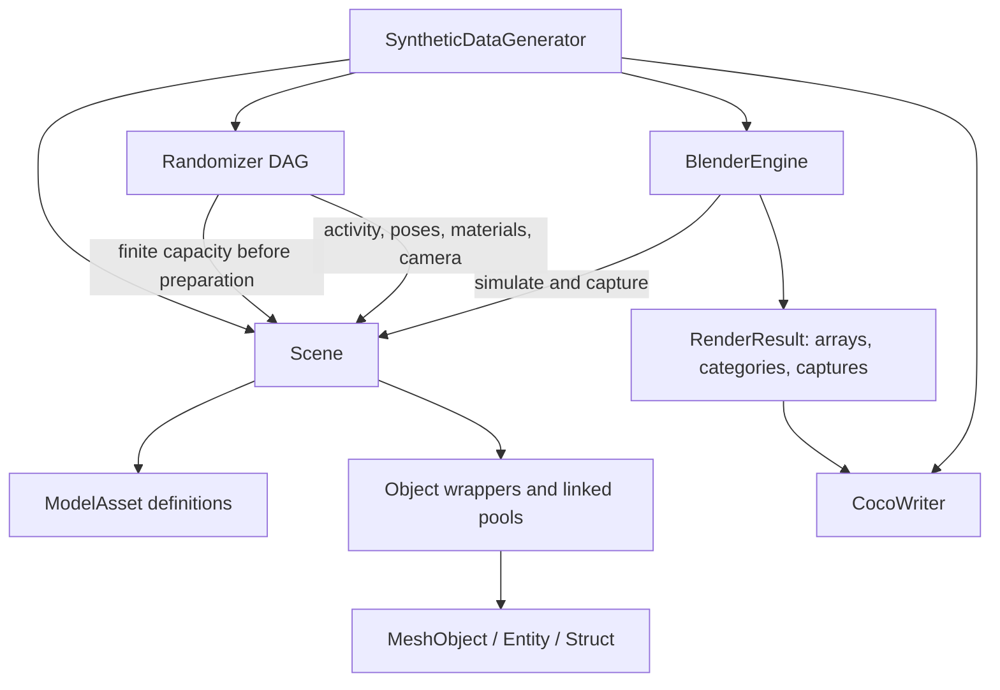

# bpy-illusion

A BlenderProc-free revision of telekinesis-illusion. It uses the standalone
`bpy==4.2.17` package and retains the modified BlenderProc algorithms for
rendering, physics, object wrappers, and undo/reference restoration.

The Python namespace remains `telekinesis.illusion` so existing samplers,
material recipes, workers, and dataset tooling keep their imports. Install this
distribution in its own environment; do not install both implementations into
the same namespace in one environment.

## Install and run

Use Python 3.11 and a supported Blender rendering device. The examples default
to CUDA; `BlenderEngine(RenderConfig(device="CPU"))` selects CPU rendering:

```powershell
conda create -n telekinesis-illusion python=3.11
conda activate telekinesis-illusion
python -m pip install -e .
```

Run the exmamples:
```powershell
python examples/quickstart_flying_things.py --no-preview
```
```powershell
python examples/quickstart_parts_in_bin.py --no-preview
```
```powershell
python examples/generate_synthetic_data_with_bin_picking_worker.py
```

The bin-worker example reads `configs/example_bin_picking_gearwheel_2.yaml`
directly. Edit that YAML for dataset settings or change `spec_file` in the
example. Set `preview=True` in `merge_shards()` to open the viewer.
For command-line overrides, use
`python examples/bat_scripts/generate_synthetic_data_with_bin_picking_worker.py --help`.

The checkout includes the original example assets. For another asset tree,
pass `asset_dir` to `Scene`, or set `metadata.asset_directory` in the worker
YAML. Relative YAML asset paths resolve against that YAML file. Interactive
FiftyOne previews are optional: `python -m pip install -e ".[viewer]"`.

For a short real render:

```powershell
python examples/quickstart_parts_in_bin.py --no-preview --num-images 3 --resolution 64 --samples 2 --seed 17 --output-dir output/smoke
```

## Windows batch pipeline

For the optional generation-and-training pipeline, see
[the batch examples](examples/bat_scripts/README.md). Its dedicated entrypoints
retain the Windows forced-exit workaround; the standard examples use normal
Python shutdown.

## Build one dataset run

Register models on a scene, configure the existing randomization DAG, then
pass the scene, randomizer, engine and writer to the generator. Instance counts
are configured on the DAG's composition nodes, independently of model metadata.

```python
from telekinesis.illusion.core.scene import Scene
from telekinesis.illusion.core.engine import BlenderEngine, RenderConfig
from telekinesis.illusion.core.synthetic_data_generator import SyntheticDataGenerator
from telekinesis.illusion.randomizer.randomizer import Randomizer
from telekinesis.illusion.randomizer.randomizer_node import (
    ObjectInstanceRandomizer, ObjectPoseRandomizer, CameraPoseRandomizer,
)
from telekinesis.illusion.sampler.camera_pose_sampler import shell_sampler
from telekinesis.illusion.types.light import Light
from telekinesis.illusion.types.model_asset import ModelAsset
from telekinesis.illusion.writer.writer import CocoWriter

scene = Scene()
scene.add(ModelAsset("assets/models/mechanical_parts/gearwheel_1.glb",
                     object_name="gear", category_name="gear", category_id=1))
scene.add(Light("key", "POINT", power=40.0, location=(0.0, 0.0, 1.0)))

randomizer = Randomizer()
randomizer.add_randomizer(ObjectInstanceRandomizer({"gear": (1, 3)}), "counts")
randomizer.add_randomizer(
    CameraPoseRandomizer(shell_sampler, number_of_views=2,
                         radius_min=0.5, radius_max=0.7), "camera"
)
# Add ObjectPoseRandomizer, materials, background and lights as shown in the
# quickstarts. DAG dependencies and stage filtering retain their existing API.

generator = SyntheticDataGenerator(
    scene=scene,
    randomizer=randomizer,
    engine=BlenderEngine(RenderConfig(samples=32)),
    writer=CocoWriter(output_dir="output/gears"),
)
generator.generate(num_images=100)
```

`scene.add()` accepts a `ModelAsset` or a `Light`. Model registration returns a
normalized copy with an absolute path, validated scale and resolved category;
the input specification stays unchanged. Omit category fields to use the model
name and an automatically assigned ID. Construct lights after creating the
scene; `add()` registers and returns the supplied light, accessible through
`scene.get_light(name)` and `scene.get_lights()`.

`generate()` prepares automatically. Call `generator.prepare()` explicitly if
you need to inspect instantiated objects or set fixed transforms first. Before
preparation, `scene.get_assets()` contains immutable `ModelAsset` definitions
and `scene.get_objects()` contains no imported model instances. Afterward, the
flat object dictionary and per-model groups refer to the same `Object` wrappers.

`num_images` is an exact number of camera views. `num_samples` instead counts
randomized scenes and renders all configured camera views. This removes the old
image-count overshoot when the last batch contained multiple views. The
procedural worker uses `num_samples=1` for each arrangement.

## Ownership and lifecycle



The generation loop lives in `core/synthetic_data_generator.py`: prepare,
reset pool activity, execute the DAG, simulate if requested, update light poses,
render, and write. Simulation settings and rendering details live in
`core/engine.py`. The generator cleans up in `finally` unless a worker requests
that the pool remain available for the next shard.

- `Scene` owns model definitions, instance pools, the category mapping, lights,
  camera, background, and material cache. Blender owns transforms and materials;
  they are accessed through wrappers rather than copied into parallel state.
- Camera pose randomization follows BlenderProc: it reuses the camera's action
  and curves, overwriting poses at the same frame indices across samples. It
  does not clear animation data or reset the frame range. Use a fixed view
  count within a scene; reducing it leaves earlier views and their keys in place.
- `Randomizer.required_instances()` sums enabled DAG nodes once in topological
  order. Multiple composition nodes requesting one asset reserve additive
  capacity and activate distinct available objects. Modifier nodes request no
  capacity. Custom nodes must declare finite integer upper bounds; pool growth
  inside the sample loop is unsupported.
- `Scene.activate()` and `deactivate()` keep rendering visibility, rigid-body
  participation and the active-name index consistent. Low-level wrapper `hide()`
  remains available, but is not the activity API. The engine reuses one invisible
  physics catch plane across samples and shards, repositioning it beneath the
  current bin. It is collidable only during simulation, then hidden and disabled
  even on failure. Final generator cleanup releases the plane and its mesh.
- Linked instances share mesh data. Material slots use object-level overrides,
  so replacing an instance's material does not replace its siblings' slots.
  Existing material and UV preprocessing behavior is retained.
- `RenderResult` has pass arrays, a category snapshot, and per-view capture
  metadata. The writer can operate after Blender cleanup. It validates taxonomy
  compatibility before appending and retains registered categories even when
  they are absent in a particular image.

Register assets before preparation. A prepared scene can reuse its pool for
smaller count ranges; a larger capacity requires a new scene. There is no dirty
configuration graph or implicit scene rebuild. The process has one active bpy
scene; constructing another `Scene` replaces it. The current importer continues
to assume a single mesh per model.

`Context` is a compatibility import for `Scene`. Replace `add_model(...)` with
`add(ModelAsset(...))` and `add_light(...)` with `add(Light(...))`. Instance-count
arguments belong to `ObjectInstanceRandomizer`.
Legacy generator physics keywords remain accepted for existing workers; new
scripts should pass a `PhysicsConfig` to their engine.

## Shards and restarts

`BinPickingWorker` prepares once and reuses its linked pools between shards.
Each shard has a UUID in its directory name. Restarting with the same dataset
name adds shards, and `merge_shards()` writes `merged_coco_annotations.json`.
The merger validates category ID/name compatibility. Keep explicit category IDs
stable between runs. Format export directories retain the existing overwrite
protection; set `output.dataset_format: null` for repeated accumulation and
perform export after generation.

## Modules

```text
src/telekinesis/illusion/
  core/          scene, engine, synthetic_data_generator, context compatibility
  types/         model_asset, render_result, object, camera, light, material recipes
  randomizer/    existing DAG and nodes, pure instance_counts, material sampling
  blender/
    types/       struct, entity, mesh_object, material, light, reference tracking
    loaders/     object and material loaders, material helpers
    camera/      settings, projection, validation, lens_distortion
    rendering/   renderer, output loading, segmentation, optical_flow
    undo.py      undo checkpoints and wrapper reference restoration
    physics.py   simulation and final-pose extraction
    collision.py filters.py postprocessing.py
    initialization.py utility.py utils.py storage.py
  writer/        Blender-independent COCO writing and parent-mask annotations
  workers/       bin-picking shards and procedural arrangements
  sampler/       existing pose samplers
  dataset/       shard merger and format conversion
  viewer/        optional dataset preview
```

Camera projection/validation, lens distortion, filters, depth/distance conversion,
noise postprocessing, optical flow, and the separate recoloring segmentation
renderer remain available in `blender/`. The normal engine segmentation path
continues to use the object-index pass. These are the existing algorithms with
local imports, not replacements invented for this revision. Source attribution
and the upstream license are in `blender/NOTICE.md` and `LICENSE.BlenderProc`.

Undo retains the modified BlenderProc approach: collect valid weakly tracked
`Struct` wrappers, push a Blender checkpoint, undo on exit (also on exceptions),
and rebind wrappers by their saved names. `Material` and `Background` refresh
their cached shader references too. Undo covers Blender state; it does not roll
back arbitrary Python lists or configuration objects. Wrappers created inside
an undone block must not escape it.

## Tests

```powershell
python -m pip install -e ".[test]"
python tools/run_tests.py -q
```

The runner preserves pytest's real exit code while avoiding the known standalone
bpy 4.2 Windows interpreter-teardown crash. Library methods never force process
exit. The bin-picking CLI and both quickstarts use normal Python shutdown,
allowing exit handlers to run.
The underlying native shutdown crash may still occur after a successful export.

Tests reject every `blenderproc` import. They exercise the three requested example
scripts in subprocesses, decode their COCO masks, check image/capture alignment,
and restart the shard worker. Other coverage includes linked mesh/material
behavior, repeated physics/undo, failed renders, capacity planning, inactive
objects, category compatibility, depth/normals, optical flow, recoloring
segmentation, camera projection and lens remapping. Example smoke tests use
64-pixel images and two Cycles samples to keep actual rendering inexpensive.
